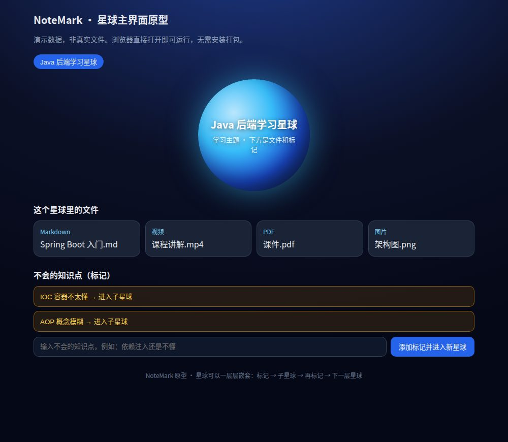

# NoteMark

一款开源笔记软件。

## 项目简介

NoteMark 用“星球”来组织学习：一个星球就是一个学习主题，遇到不会的知识点就做标记，点开标记进入新的星球继续学，一层层往下钻，直到把这个知识点彻底搞懂。

## 运行截图

## 技术栈

- 后端：Spring Boot
- 前端：Vue
- 数据库：MySQL

## 核心概念：星球模型

- **星球 = 学习主题**：网页上一个大星球就是一个学习主题。
- **星球里放文件**：点进星球，可以放入多个不同格式的文件：md、图片、视频、pdf 等。
- **标记 = 不会的知识点**：学习时遇到不会的知识点，对它进行标记。
- **点击标记进入新星球**：新星球里可以放多个不同类型、不同格式的资料，对这个知识点进行讲解和补充。
- **递归嵌套**：第二个星球同样可以进行标记，点开进入第三个星球，如此一层层嵌套下去。

## 使用流程

1. 创建一个星球，作为一个学习主题。
2. 往星球里放入多个不同格式的学习文件（md、图片、视频、pdf 等）。
3. 学习时遇到不会的知识点，打上标记。
4. 点击标记，进入为这个知识点新建的星球。
5. 在新星球里放入多个不同格式的讲解、补充资料。
6. 新星球里遇到新的不会的点，继续标记、继续进入下一层星球。

## 运行演示

浏览器直接打开 `demo/index.html` 即可体验星球主界面（需要联网加载 Vue CDN）：大星球学习主题、多格式文件列表、点击标记进入子星球、面包屑路径与返回上一层、添加标记生成新的子星球。

## 后续计划

- 星球内文件预览：md 渲染、PDF 阅读、视频播放
- 标注与笔记导出
- 知识星球图谱视图
- 账号同步、多设备、多人协作

## 贡献

欢迎提交 Issue 与 Pull Request。

## 开源协议

MIT。
